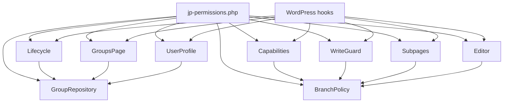
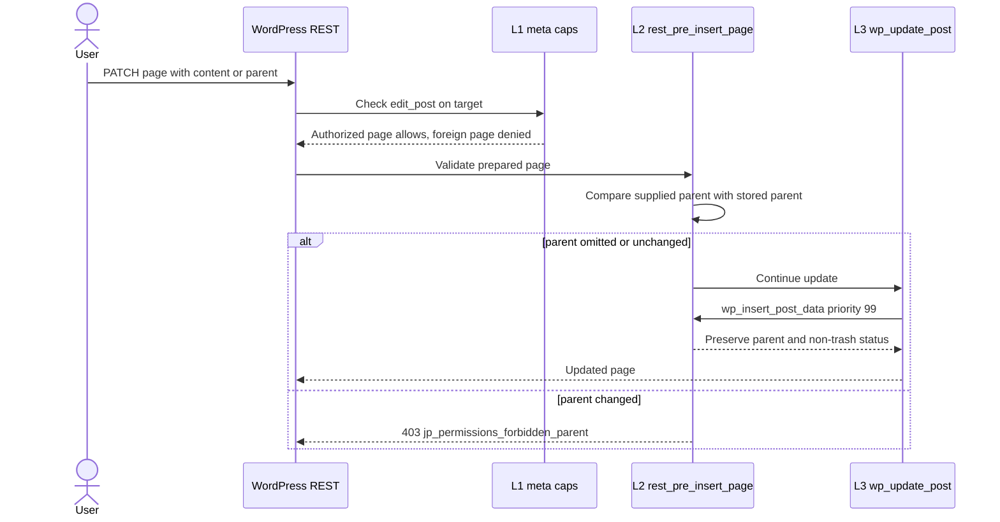
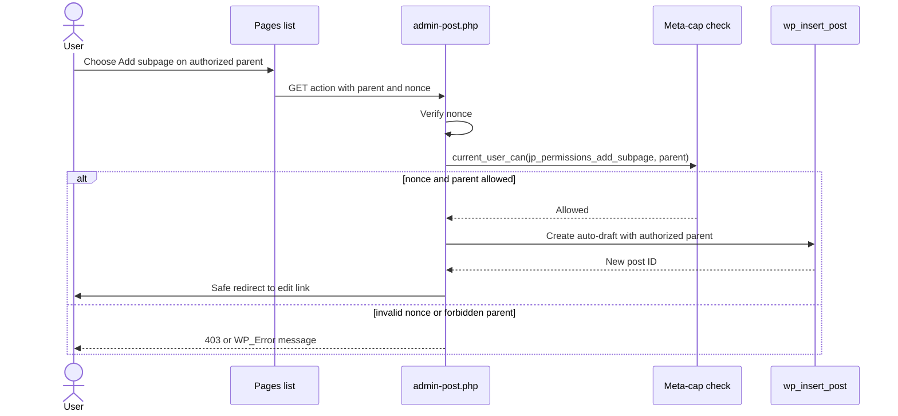
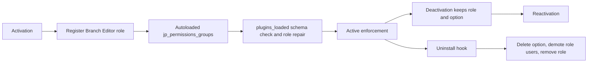

# Page Branches architecture

## Components



All classes are `final` in namespace `JayPee\Permissions`, with static `init()` registration following `includes/class-updates.php`.

## Class responsibilities and public API

| Class | API and responsibility |
|---|---|
| `GroupRepository` | `all(): array` normalized groups keyed by ID; `get(int $id): ?array`; `save(?int $id, string $name, int[] $roots, int[] $members): int|WP_Error` (validate FR-01/02; errors `jp_permissions_invalid_name`, `jp_permissions_duplicate_name`); `delete(int $id): void`; `remove_root(int $page_id): void`; `remove_member(int $user_id): void`; `groups_for_user(int $user_id): array`; constants `OPTION = 'jp_permissions_groups'`, `SCHEMA = 1`. One autoloaded option stores schema, next_id (IDs never reused), groups; malformed data normalizes fail-closed. |
| `BranchPolicy` | `is_restricted(int $user_id): bool` (user is a group member and role-derived capabilities lack `edit_others_pages`; ID 0 false); `roots_for(int $user_id): int[]` (memoized); `authorized_page_ids(int $user_id): int[]` (roots plus all descendants, memoized; used by the Pages list); `is_authorized_page(int $user_id, WP_Post $page): bool`; `is_restricted_context(): bool` (`is_restricted(get_current_user_id()) && ! wp_doing_cron()`); `reset(): void` clears memo, hooked to `update_option_jp_permissions_groups`, `add_option_jp_permissions_groups`, and usable by tests. |
| `Capabilities` | Hooks `user_has_cap` (priority 10, 4 args): add `edit_pages`, `edit_others_pages`, `publish_pages` only for group members whose role-derived capabilities lack `edit_others_pages`. The restriction/admin test is role-derived `$user->allcaps['edit_others_pages']`; membership only grants access and never removes role-granted access. Hooks `map_meta_cap` (priority 10, 4 args) per table. Registers `jp_branch_editor` role (`read`, `upload_files`). |
| `WriteGuard` | Hooks `rest_pre_insert_page` (10, 2), `wp_insert_post_data` (99, 4), and `pre_trash_post`/`pre_untrash_post`/`pre_delete_post` (10, 3). L2/L3 enforce parent, root slug/status, menu order, and trash restrictions on page writes. |
| `Subpages` | Hooks `page_row_actions` (“Add subpage”), `admin_post_jp_permissions_add_subpage`, `load-post-new.php` redirect, `admin_notices` for `jp_permissions_notice`, `admin_menu` (remove Add New Page for restricted users), `admin_bar_menu` priority 999 (remove `new-page`), and `pre_get_posts` on the `edit.php` page list (restricted users: `post__in` = `BranchPolicy::authorized_page_ids()`, empty set yields no rows). |
| `GroupsPage` | Users → “Page Branches”, slug `jp-permissions-branches`, `manage_options`, load hook `load-users_page_jp-permissions-branches`; manages group list/edit/delete using nonces `jp_permissions_save_group` and `jp_permissions_delete_group_{group_id}`. |
| `UserProfile` | `show_user_profile`/`edit_user_profile`: read-only group/root list for administrators and the profile owner. |
| `Editor` | `enqueue_block_editor_assets`; enqueue only for restricted user editing a page. Script `jp-permissions-editor`, `assets/js/editor.js`, dependencies `wp-data`, `wp-dom-ready`, `wp-editor`. |
| `Lifecycle` | Activation (refused with a translated message when `is_multisite()`), upgrade, and uninstall, plus `deleted_post`/`deleted_user` cleanup hooks delegating to repository. |

## Meta-capability mapping

Applied only when the user is restricted and the target resolves to a page, or to an attachment for `edit_post`; revisions resolve to parent; other cases return original `$caps`. Core `map_meta_cap` filter receives `($caps, $cap, $user_id, $args)` (`wp-includes/capabilities.php:879 (WordPress 7.1.3)`); edit/read mapping is status- and author-sensitive (`wp-includes/capabilities.php:188-289`).

| Meta capability | Authorized page | Unauthorized page |
|---|---|---|
| `edit_post`, `edit_page` | `['edit_pages']`, plus `manage_privacy_options` if present in core `$caps` | `['do_not_allow']` |
| `publish_post` | `['publish_pages']` | `['do_not_allow']` |
| `read_post`, `read_page` | `['read']` | Core `$caps` unchanged |
| `delete_post`, `delete_page` | `['do_not_allow']` | `['do_not_allow']` |
| `jp_permissions_add_subpage` (any user) | Parent must exist and be page not `trash`/`auto-draft`, otherwise deny; parent ID 0/missing denies; unrestricted user maps to `['edit_pages']`; restricted user maps to `['edit_pages']` only for authorized parent | `['do_not_allow']` |

Attachments ([ADR 0016](../adr/0016-restricted-users-edit-own-uploads.md)): `edit_post` on an attachment whose author is the restricted user maps to `['upload_files']`, enabling client-side sub-size sideloading, crop/rotate, and attachment details; other users' attachments and all attachment deletion keep core `$caps`.

Core resolves `edit_post`/`read_post` revisions to parents (`wp-includes/capabilities.php:214-220,314-318`).

## Enforcement layers

Only restricted context (current user is a group member whose role-derived capabilities lack `edit_others_pages`, and not `wp_doing_cron()`) is guarded; membership never removes role-granted access. L1 core object checks use meta caps.

L2 `rest_pre_insert_page` checks creates with `user_can(current_user, 'jp_permissions_add_subpage', (int) ($prepared->post_parent ?? 0))`; missing/root/unauthorized parent returns `WP_Error('jp_permissions_forbidden_parent', __('You are not allowed to place a page here. Pages can only be created inside your page branches, and only administrators can move pages.', 'jp-permissions'), ['status' => 403])`. On updates, a supplied parent differing from stored parent returns the same error. On existing branch roots (any group root), supplied slug or status differing from stored value returns `WP_Error('jp_permissions_forbidden_root_change', __('Only administrators can change the address or status of a branch root page.', 'jp-permissions'), ['status' => 403])`. On any existing page, supplied menu order differing from stored value returns `WP_Error('jp_permissions_forbidden_order', __('Only administrators can change the order of pages.', 'jp-permissions'), ['status' => 403])`. On create, non-zero menu order returns the same `jp_permissions_forbidden_order` error/message. Omitted or unchanged values are allowed. REST `rest_pre_insert_page` is called for create/update and WP_Error aborts writes (`wp-includes/rest-api/endpoints/class-wp-rest-posts-controller.php:741-759,944-963,1531`).

L3 `wp_insert_post_data` priority 99, for pages only: inserts require an authorized parent and retain default `menu_order` 0; updates preserve parent and menu order and cannot change status into or out of `trash`. For any page that is a root of any group, restricted users may edit content and title but cannot change slug or status. These restrictions apply irrespective of which group authorizes the user; descendants remain editable, including slug and status. Violations call `wp_die($message, __('Forbidden', 'jp-permissions'), ['response'=>403,'back_link'=>true])`: parent uses `jp_permissions_forbidden_parent` and “You are not allowed to place a page here. Pages can only be created inside your page branches, and only administrators can move pages.”; root slug/status uses `jp_permissions_forbidden_root_change` and “Only administrators can change the address or status of a branch root page.”; page order uses `jp_permissions_forbidden_order` and “Only administrators can change the order of pages.”; trash transitions use `jp_permissions_forbidden_delete` and “Only administrators can trash, restore, or delete pages.” Revisions are not guarded. `wp_insert_post_data` cannot return an error (`wp-includes/post.php:4978`); `wp_update_post` merges stored data, preserving omitted parent.
L4 `pre_trash_post` and `pre_untrash_post` return `false`; `pre_delete_post` returns `false` except auto-drafts; only restricted context/page. Core exposes these short-circuit hooks (`wp-includes/post.php:3871,4111,4193`). Direct `$wpdb` writes and system context are trusted.





## Admin UI

| View | Specification |
|---|---|
| Group list | `widefat striped`: Name; roots as edit links with status label for non-published roots; members whose role-derived capabilities include `edit_others_pages` marked “unrestricted”; Edit/Delete row actions; Add group button. |
| Edit | `form-table`; name input; current roots listed as hierarchical page paths with status label and a “Remove” checkbox each; one “Add root” `wp_dropdown_pages()` select (pages in publish/draft/pending/private/future, `sort_column` `menu_order,post_title`, indented by hierarchy, empty “— None —” option) adding at most one root per save; member checkboxes ordered by display name showing `display_name (user_login) — role`. |
| Delete | Confirmation screen with Delete group submit and Cancel link. |
| Save | On `load-users_page_jp-permissions-branches`, verify nonce and `manage_options`, validate. Success redirects with `updated=1`/`deleted=1`; validation re-renders values with `notice-error`. Invalid/non-page roots and unknown users are silently dropped. |

Effective permissions are visible in list view and user-profile section. Pages-list Branch column is a Could item.

## Gutenberg

For restricted page editors, enqueue `assets/js/editor.js` without a build step and call `wp.data.dispatch('core/editor').removeEditorPanel('page-attributes')` on DOM ready. The panel renders `ParentRow` (`wp-includes/js/dist/editor.js:83129-83146,78150-78157`); this hides parent and menu-order UI only, not a security boundary. Classic Editor and Quick Edit controls remain visible; server rejects moves. Auto-draft opened via `post.php` works (`wp-admin/edit-form-blocks.php:146-151`); autosave preserves parent, revisions work, and preview/schedule/publish rely on granted primitives. Link-UI page creation submits no parent and returns 403 (`wp-includes/js/dist/block-library.js:13154-13182`). A DataViews `parent` field exists; whether it renders as editable control is UNVERIFIED. Parent choices are not permission-filtered (`wp-includes/js/dist/editor.js:82930-82955`).

## Performance and lifecycle

No plugin DB queries on anonymous front-end requests beyond autoloaded option. Per capability check, ancestry work is O(depth) and uses post object cache; memoize user-to-root set per request and clear on `update_option_jp_permissions_groups` and `add_option_jp_permissions_groups`. Scale target: 500 pages, 30 restricted users, 10 groups.



Upgrade uses `Lifecycle::maybe_upgrade()` on `plugins_loaded`, compares schema with `GroupRepository::SCHEMA = 1`, and re-adds missing role. Uninstall uses `register_uninstall_hook(PLUGIN_FILE, [Lifecycle::class, 'uninstall'])`; root `uninstall.php` is not shipped by release script (`scripts/build-release.sh:43-47`). Deactivation retains role and option.

## File layout

```text
jp-permissions.php                 # bootstrap and uninstall hook registration
includes/class-group-repository.php
includes/class-branch-policy.php
includes/class-capabilities.php
includes/class-write-guard.php
includes/class-subpages.php
includes/class-groups-page.php
includes/class-user-profile.php
includes/class-editor.php
includes/class-lifecycle.php
assets/js/editor.js
tests/integration/                  # fixtures, bootstrap, integration cases
tests/seed.php
phpunit-integration.xml.dist
.github/workflows/integration.yml
```

`phpcs.xml.dist` needs no change: `includes` is already covered.
