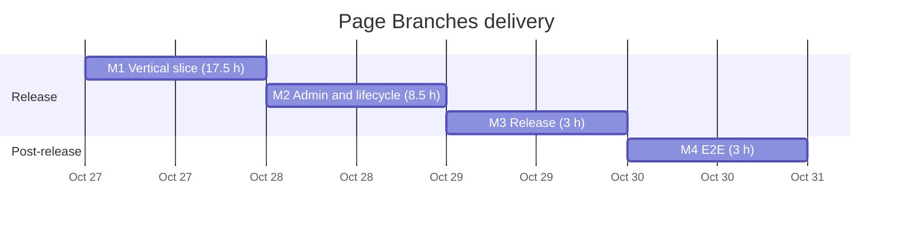

# Implementation plan

## MoSCoW summary

Must and Should scope is organized into four milestones. M1 proves the authorization vertical slice; M2 adds administration and lifecycle; M3 adds the remaining release Musts (CI, user documentation, Yoast SEO check). M1–M3 (29 h) gate the first production site. M4 adds Playwright E2E after release. Could items are outside the estimate; Won't items are the explicitly excluded requirements in [Requirements](requirements.md).

## Backlog

| ID | Item | MoSCoW | Milestone | Estimate (h) | Depends on | ACs |
|---|---|---|---|---:|---|---|
| B-01 | `GroupRepository` and normalization | Must | M1 | 2 | — | AC-01–03, AC-27 |
| B-02 | `BranchPolicy` | Must | M1 | 2 | B-01 | AC-04–10, AC-28 |
| B-03 | `Capabilities` (incl. own-attachment mapping), role registration, `Lifecycle` activation incl. multisite refusal | Must | M1 | 3 | B-01, B-02 | AC-08–10, AC-29–30, AC-34–35 |
| B-04 | `WriteGuard` | Must | M1 | 3 | B-02, B-03 | AC-05–06, AC-16–22, AC-25, AC-28, AC-31–32 |
| B-05 | `Subpages` creation, restricted navigation, and Pages-list limit | Must | M1 | 2.5 | B-02–04 | AC-11–15, AC-33 |
| B-06 | Integration harness and full authorization matrix | Must | M1 | 5 | B-01–05 | AC-01–20 |
| B-07 | `GroupsPage` admin UI | Must | M2 | 4.5 | B-01–02 | AC-01–03 |
| B-08 | `UserProfile` membership/root display | Should | M2 | 1 | B-07 | AC-01, AC-08 |
| B-09 | Root/user cleanup hooks | Must | M2 | 0.5 | B-01 | AC-23–25 |
| B-10 | `Editor` Gutenberg parent-panel script | Should | M2 | 1 | B-03–04 | AC-26 |
| B-11 | Hide Add New in submenu/admin bar | Must | M2 | 0.5 | B-05 | AC-13 |
| B-12 | Upgrade and uninstall lifecycle | Must | M2 | 1 | B-03 | AC-30 |
| B-13 | Playwright E2E and seed; add E2E step to the integration workflow | Should | M4 | 3 | B-05, B-10, B-14 | AC-11, AC-26 |
| B-14 | Integration workflow | Must | M3 | 1 | B-06 | AC-01–35 |
| B-15 | `readme.txt` / README user documentation | Must | M3 | 1 | B-07, B-12 | AC-01–35 |
| B-16 | Manual compatibility check as a Branch Editor in Gutenberg: Yoast SEO fields and an image upload with client-side processing; record results in FR-10 | Must | M3 | 1 | B-04–06 | AC-05, AC-17, AC-35 |
| B-17 | Pages-list status counts limited to authorized pages (`wp_count_posts` filter) | Could | — | Not estimated | — | — |
| B-18 | Admin “Branch” column on Pages list | Could | — | Not estimated | — | — |
| B-19 | Hide parent controls in Classic Editor/Quick Edit | Could | — | Not estimated | — | — |
| B-20 | Front-end admin-bar “Add subpage” | Could | — | Not estimated | — | — |
| B-21 | Per-group review mode: members may only submit for review (`pending`) | Could | — | Not estimated | — | — |
| B-22 | Hide slug and status controls on branch roots in Gutenberg for restricted users | Could | — | Not estimated | — | — |

Won't: custom post types, WooCommerce, media isolation, frontend visibility rules, editorial workflows beyond B-21, per-field/per-block permissions, multisite, frontend editing, replacing user management, and a general ACL system; also Classic Editor UI polish, editor page moves, and editor deletion.

## Estimate and milestones

| Milestone | Scope | Estimate |
|---|---|---:|
| M1 — Vertical slice | B-01–B-06; seed groups via `wp option update jp_permissions_groups --format=json` or fixtures; no admin UI | 17.5 h |
| M2 — Admin and lifecycle | B-07–B-12 | 8.5 h |
| M3 — Release | B-14–B-16 | 3 h |
| M4 — Post-release E2E | B-13 | 3 h |
| Total Must + Should | M1–M4 | 32 h |

The overall estimate is 32 h, slightly above the 16–30 h target, primarily because release-quality E2E and compatibility work are included. M1–M3 total 29 h and gate the first production site; M4 follows after go-live.

### First vertical slice: M1

Build the end-to-end authorization path before an admin UI exists. Seed representative groups and users through fixtures or the option; implement group normalization, branch policy, capabilities/role, write guards, and Add subpage; then exercise them through WordPress integration tests.

**Exit criteria:** integration matrix is green; AC-01–AC-20 and AC-31–AC-35 are met via tests; authorized descendants can be edited and published; cross-branch reads/writes, root creation, unauthorized parent/order changes, root slug/status changes, and deletion are denied; restricted users' Pages list shows only authorized pages; restricted users can upload and edit only their own attachments; valid Add subpage creates an auto-draft under an authorized parent. Admin group UI and cleanup/uninstall work are completed in M2.

## Risk register

| ID | Risk | Likelihood | Impact | Mitigation |
|---|---|---|---|---|
| R-01 | PHPUnit 10.5 may be incompatible with the WordPress test library (UNVERIFIED). | Medium | High | Use `yoast/phpunit-polyfills:^1.1`; if the WP test library fails under PHPUnit 10.5, pin PHPUnit `^9.6` repository-wide and record the choice in [ADR 0009](../adr/0009-integration-test-stack.md). |
| R-02 | Gutenberg parent UI may move into a DataForm field. | Medium | Medium | UI hiding is supplementary; keep server-side parent-change enforcement authoritative. E2E checks hidden UI or 403 on attempted change. |
| R-03 | Third-party plugins may write page data outside WordPress authorization APIs. | Medium | High | Document direct-SQL writers as outside the trust boundary; assess the target compatibility stack in B-16. Write paths not covered by the target stack remain outside the compatibility assessment. |
| R-05 | Corrupt option data can remove Branch Editor access. | Low | High | Normalize malformed/missing data to empty configuration (fail closed for Branch Editors); membership does not restrict Editor-role users with native page capabilities. Test the fail-closed behavior. |
| R-06 | `copier update` may introduce template drift, especially around `composer.json`. | Medium | Medium | Resolve template conflicts deliberately during updates; keep the integration workflow repo-local and preserve the template-owned CI workflow. |
| R-07 | Block-editor client-side media processing (WordPress 7.1+, HTTPS) may call attachment routes beyond those covered by ADR 0016; runtime behavior for Branch Editors is UNVERIFIED. | Medium | Medium | AC-35 integration test against sideload/update routes; confirm an image upload as `fb` in the editor during B-16. |

## Open questions / defaults

None open; see [Decisions](decisions.md).
