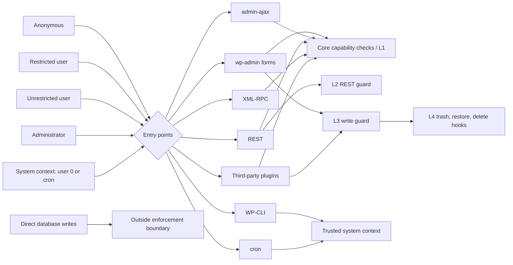

# Security model

> [!warning] Authorization is enforced at the server-side operation boundary. Hiding controls is supplementary usability only; every write path must be checked independently.

## Trust boundaries

## Core operations and low-level writes

Core object operations check meta capabilities such as `edit_post`; `map_meta_cap` applies with `($caps, $cap, $user_id, $args)` (`wp-includes/capabilities.php:879 (WordPress 7.1.3)`). REST page updates check `edit_post` and parent is otherwise validated only for existence (`wp-includes/rest-api/endpoints/class-wp-rest-posts-controller.php:687-734,893-940,1446-1469`). Revisions resolve to their parent for edit/read checks (`wp-includes/capabilities.php:214-220,314-318`).

`wp_insert_post()` and `wp_update_post()` do not themselves enforce the caller's capability. Therefore L2 REST preparation guards REST writes and L3 `wp_insert_post_data` guards core and plugin API writes; L4 hooks block delete/trash/restore. `wp_insert_post_data` cannot return an error (`wp-includes/post.php:4978`). Third-party direct SQL writes bypass these controls and are outside the trust boundary. System context (current user ID 0 or `wp_doing_cron()`) is trusted and unrestricted.

## Threat register

| Threat | Attack path | Mitigation layer | Residual risk | Test IDs |
|---|---|---|---|---|
| T-01 Direct edit URL / IDOR on unauthorized page | Restricted user opens foreign page via `post.php` or REST item URL. | L1 `map_meta_cap` maps foreign page edit to `do_not_allow`; REST update checks `edit_post` (`class-wp-rest-posts-controller.php:687-734,893-940`). | Page-list titles remain visible; a direct URL does not grant access. | AC-05; `test_edit_post_fb`, `test_edit_post_tennis`; `test_rest_update_parent_fb` |
| T-02 Parent/order manipulation (REST `parent`/`menu_order`, classic `parent_id`, Quick Edit `post_parent`/order, bulk edit) | Supply a different parent or order while updating an authorized page through REST, classic edit, Quick Edit, or bulk edit. | L2 compares supplied REST parent and order; L3 compares stored parent and order on all page writes and requires order 0 for inserts. | Trusted direct SQL remains outside boundary; concurrent admin changes may race. | AC-16, AC-17, AC-32; `test_rest_update_parent_fb`, `test_classic_parent_change_fb`, `test_quick_edit_parent_fb`, `test_bulk_edit_parent_fb`, `test_menu_order_change_denied_restricted` |
| T-03 Creating pages at root or in foreign branch (REST, `post-new.php`, Link UI) | Create with parent 0/foreign parent, use generic `post-new.php`, or Gutenberg link-UI create. | L2/L3 require `jp_permissions_add_subpage` on authorized parent; `load-post-new.php` redirects; UI row action uses nonce and capability. REST parent is existence-only in core (`class-wp-rest-posts-controller.php:1446-1469`). | Gutenberg link-UI sends no parent and deliberately gets 403; admins retain creation. | AC-11–AC-15; `test_rest_create_root_fb`, `test_rest_create_foreign_parent_fb`, `test_post_new_redirect_fb`, `test_add_subpage_valid_fb` |
| T-04 Capability/primitive escalation (granted primitives, XML-RPC `edit_pages`) | Use broad primitive grants or author reassignment to target another page through XML-RPC or a plugin. | Restricted Branch Editors gain only `edit_pages`, `edit_others_pages`, `publish_pages`; users whose role-derived capabilities include `edit_others_pages` remain unrestricted. No `edit_published_pages`, `edit_private_pages`, `read_private_pages`, or delete primitives are granted. `edit_others_pages` is needed for classic author checks and REST author changes, but object operations still require `edit_post` mapped per-page. XML-RPC broad `edit_pages` checks must be followed by object checks; confirm in B-06 integration test. | Author reassignment on authorized pages is accepted; XML-RPC behavior requires explicit B-06 verification. | AC-08, AC-09; `test_edit_post_fb`, `test_xmlrpc_edit_foreign_page_fb` |
| T-05 Quick/bulk edit & list-table paths | Use list table inline form or bulk request to edit content/parent/status. | L1 object meta cap and L3 parent/status write guard; Quick Edit checks `edit_post` (`wp-admin/includes/ajax-actions.php:2099-2195`). | UI controls remain visible in MVP; error may be less discoverable. | AC-05, AC-16; `test_quick_edit_parent_fb`, `test_bulk_edit_parent_fb`, `test_edit_post_fb` |
| T-06 Autosave and revision paths | Attempt to alter parent or retrieve/restore another branch through autosave/revision endpoints. | Autosave uses parent controller update permission and prepared-page path; payload never includes parent. Revisions require `edit_post` on parent (`class-wp-rest-autosaves-controller.php:189-223`, `class-wp-rest-revisions-controller.php:170-210`; client payload `wp-includes/js/dist/core-data.js:18286-18317`). | Restore saves revision fields through normal update path; core behavior may evolve, so integration coverage remains required. | AC-17, AC-20; `test_autosave_autodraft_fb`, `test_revision_restore_fb`, `test_revision_list_foreign_fb` |
| T-07 Cross-branch information disclosure (drafts, preview, REST read, parent dropdown lists) | Read foreign draft/preview or infer hierarchy through page titles and unfiltered parent options. | L1 maps unauthorized `read_post` to core `$caps` unchanged; authorized read maps to `read`. Edit and REST updates remain object-guarded. The Pages list is limited to authorized pages for restricted users ([ADR 0015](../adr/0015-pages-list-limited-to-authorized-pages.md)). Parent choices are not permission-filtered (`wp-includes/js/dist/editor.js:82930-82955`). | Status counts above the Pages list reflect the whole site; parent dropdown choices can disclose page names where the panel is shown. | AC-05, AC-09, AC-33; `test_read_draft_foreign_fb`, `test_rest_read_foreign_draft_fb`, `test_pages_list_authorized_only` |
| T-08 Duplication/clone plugins | Clone a permitted or foreign page through a third-party plugin. | Clones inserted as pages pass L3 `wp_insert_post_data`, which requires an authorized parent; subsequent edits pass L1. | Plugin-specific write paths are UNVERIFIED; direct-SQL writers bypass guards (B-16 compatibility check). | AC-14, AC-15; `test_plugin_insert_foreign_parent_fb`, `test_plugin_insert_authorized_parent_fb` |
| T-09 Trash/restore/delete paths | Invoke trash, untrash, permanent delete through functions, REST DELETE, admin actions, or bulk operation. | L1 denies `delete_post`; L4 `pre_trash_post`/`pre_untrash_post`/`pre_delete_post` short-circuit; L3 rejects status transition into/out of `trash`. Core hooks are at `wp-includes/post.php:3871,4111,4193`; REST DELETE checks `delete_post` (`class-wp-rest-posts-controller.php:1065-1080`). | Auto-draft cleanup is allowed; trusted administrators can permanently delete roots, causing descendants to be reparented out of branch. | AC-21–AC-25; `test_trash_fb`, `test_untrash_fb`, `test_delete_fb`, `test_rest_delete_fb`, `test_admin_delete_root_cleans_roots` |
| T-10 CSRF/privilege on group admin screen and config tampering | Forge group create/edit/delete or submit tampered option values. | `manage_options` check and action-specific nonces on screen load and before save; normalize IDs with `absint`, reject invalid/duplicate names, validate roots/users, escape output. | A privileged administrator can intentionally change all memberships; concurrent edits use documented last-write-wins semantics. | AC-01–AC-03, AC-27; `test_group_create_requires_admin`, `test_group_save_nonce`, `test_corrupt_option_no_grants_fb` |
| T-11 Hierarchy cycles | Create self-parent or cyclic hierarchy and trigger ancestry authorization. | Use `get_post_ancestors`, which stops on missing parent, self-parent, or repeat (`wp-includes/post.php:1190-1215`); core `wp_check_post_hierarchy_for_loops` also guards hierarchy changes. | No depth limit; cycles terminate but fail closed when no assigned root is found. | AC-28; `test_cycle_denies_fb` |
| T-12 Race / TOCTOU and concurrent admin edits | Admin concurrently changes page ancestry or groups while restricted request checks authorization and writes. | Check permission and parent immediately before write in same request; repository memo reset on option mutation. | Concurrent administrator reparenting can race; accepted bounded risk. Membership changes apply next request; group saves are last-write-wins. | AC-16, AC-17; `test_parent_change_race_fb`, `test_group_change_applies_next_request_fb` |
| T-13 Administrator actions with security impact (root deletion, role change) | Admin trashes/deletes branch root or changes roles/membership of an editor. | Administrators are unrestricted; permanent `deleted_post` cleanup removes deleted root IDs; core reparents children to deleted page's parent (`wp-includes/post.php:3894-3908,3996`); `deleted_user` removes membership (`wp-admin/includes/user.php:386,469`). | Trashing root preserves structural ancestry; permanent deletion moves subtree out of branch (fail-closed). Admin actions are trusted. | AC-23–AC-25, AC-30; `test_admin_trash_root_keeps_descendants`, `test_admin_delete_root_cleans_roots`, `test_delete_user_cleans_membership_admin` |
| T-14 Unauthenticated/extra endpoints surface (admin-post, AJAX, REST) | Invoke custom handlers without login, nonce, or authorization, or probe undocumented endpoints. | Register logged-in `admin_post_jp_permissions_add_subpage` only (never `admin_post_nopriv_`); verify nonce and meta cap; no custom REST routes or AJAX actions. Core REST writes stay guarded. | Core and third-party endpoints remain a broad surface; audit new endpoints whenever added. | AC-01, AC-11, AC-12, AC-14; `test_add_subpage_invalid_nonce_fb`, `test_add_subpage_unauthorized_parent_fb`, `test_rest_create_root_fb` |
| T-15 Branch root slug/status tampering | Restricted user changes the slug or status of a root of any group through REST or Quick Edit, including a root outside the user's own group. | L2 `rest_pre_insert_page` and L3 `wp_insert_post_data` compare supplied/stored values and reject changes; unchanged or omitted values pass. | Trusted direct SQL remains outside boundary; concurrent administrator changes may race. | AC-31; `test_root_slug_and_status_locked_for_restricted` |
| T-16 Media tampering | Restricted user edits, crops, sideloads onto, or deletes another user's attachment, or deletes their own. | L1 maps `edit_post` to `upload_files` only for attachments the restricted user authored; others' attachments and all attachment deletion keep core caps (`edit_posts`/`edit_others_posts`/`delete_*` not granted) ([ADR 0016](../adr/0016-restricted-users-edit-own-uploads.md)). | Shared library: a restricted user can alter their own upload even where an administrator reused it elsewhere. | AC-35; `test_restricted_user_edits_own_attachment_only` |

## Implementer checklist

- Verify nonces and capability checks before rendering privileged UI and again before every save/action; group screen requires `manage_options`.
- Normalize submitted IDs with `absint`; reject invalid names and silently drop invalid root/user IDs as specified.
- Sanitize text input with `sanitize_text_field`; escape all output in the correct context.
- Use `wp_safe_redirect`; never trust request parent IDs without meta-cap authorization.
- Do not use raw SQL for plugin writes. Core's direct SQL child reparenting on permanent deletion is a core behavior, not a plugin write path (`wp-includes/post.php:3894-3908`).
- Apply authorization to REST and non-REST writes; never rely on Gutenberg or admin-menu hiding.
- Keep system context and direct SQL within the documented trusted boundary; do not imply third-party direct-SQL compatibility.
